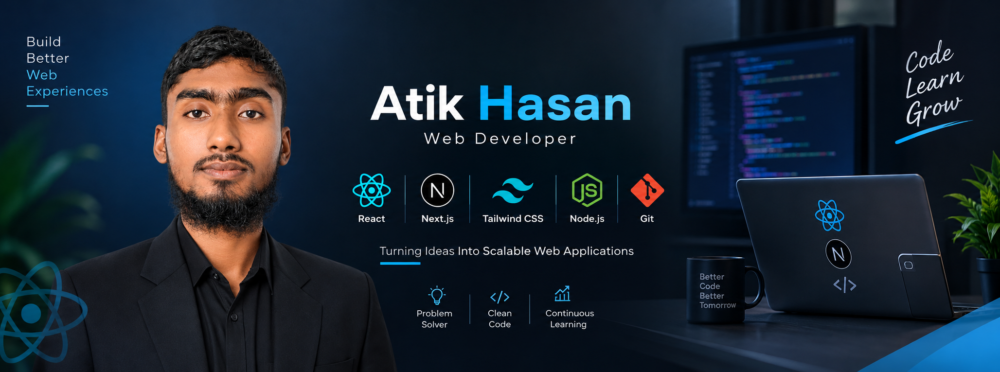

# ⚡ ATIK HASSAN | Web Developer

<!-- =============== NEON CYBER HERO =============== -->

  

   

  <!-- YOUR PROFILE PHOTO: Keep atik.png in the repository root -->

  

    

  

    

  
  

    

  
  

---

<!-- =============== ABOUT ME =============== -->

<h2 align="center">⚡ ABOUT ME</h2>

  

Hi! I'm **Atik Hassan**, a web developer from **Bangladesh 🇧🇩** who enjoys learning modern web technologies and building responsive, user-friendly applications.

I believe in learning by building, improving through practice, and writing code that solves real problems.

- 🔭 **Currently working on:** Modern web development projects
- 🌱 **Currently learning:** JavaScript, React.js, Next.js and TypeScript
- 🎯 **My goal:** Become a professional Full Stack Developer
- 💻 **Interested in:** Frontend development and modern UI design
- 🤝 **Open to:** Learning together and collaborating on projects
- ⚡ **My mindset:** Learn continuously. Build consistently. Improve daily.

---

<!-- =============== TECH ARSENAL =============== -->

<h2 align="center">🧰 TECH ARSENAL</h2>

<h3 align="center">◈ Frontend Development ◈</h3>

  

<h3 align="center">◈ Backend & Database ◈</h3>

  

<h3 align="center">◈ Tools & Workflow ◈</h3>

  

 

  
  
  

---

<!-- =============== FEATURED PROJECTS =============== -->

<h2 align="center">🚀 FEATURED PROJECTS</h2>

  

  
Explore my repositories to see my projects, experiments, and development journey.

<!-- Add individual project cards here when you want to showcase selected repositories. -->

---

<!-- =============== GITHUB CONTROL ROOM =============== -->

<h2 align="center">📡 GITHUB CONTROL ROOM</h2>

  

  

 

  

---

<!-- =============== CONTRIBUTION SNAKE =============== -->

<h2 align="center">🐍 CONTRIBUTION MATRIX</h2>

  <picture>
    <source media="(prefers-color-scheme: dark)" srcset="https://raw.githubusercontent.com/Atik-Hassan-Abddula/Atik-Hassan-Abddula/output/github-contribution-grid-snake-dark.svg" />
    <source media="(prefers-color-scheme: light)" srcset="https://raw.githubusercontent.com/Atik-Hassan-Abddula/Atik-Hassan-Abddula/output/github-contribution-grid-snake.svg" />
    
  </picture>

---

<!-- =============== CONNECT WITH ME =============== -->

<h2 align="center">🌐 LET'S CONNECT</h2>

  
  
  
  
  

---

<!-- =============== DEVELOPER QUOTE =============== -->

<h2 align="center">💡 DAILY DEVELOPER INSPIRATION</h2>

  

---

<!-- =============== NEON FOOTER =============== -->

  

    

  

    

  <strong>Thanks for visiting my digital space! 💙</strong>

   

  <em>Let's learn, create, and build something meaningful.</em>

    

  

